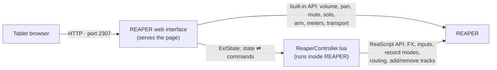

# Reaper Controller

**REAPER's mixer on your tablet, over Wi‑Fi.**

A touch mixer for REAPER that runs in any tablet browser: every track with its FX, input, record arm,
monitoring, record mode, fader with meters, pan, mute/solo, FX chain and routing. Tap a plugin and its
window opens in REAPER. Add and remove tracks, change inputs and record modes, create sends — from the couch
or the vocal booth.


- **Nothing extra to run.** The page is served by REAPER's own web server, and one Lua script inside REAPER does
  the rest. No Python, no extensions, no drivers.
- **Instant faders.** Volume, pan, mute, solo, arm, meters and transport use REAPER's built-in web API.
- Works with any browser (iPad, Android, phone, another computer) on the same network.

---

## How it works



REAPER's web interface already exposes volume, pan, mute, solo, arm, meters and transport. Everything else —
the FX list, opening plugin windows, inputs, record modes, sends, adding/removing tracks — isn't in that API,
so a small ReaScript running inside REAPER handles it. The page and the script talk through REAPER's *ExtState*
store, which the web interface can read and write: the script publishes a JSON snapshot of the mixer (only when
something changes) and runs command batches the page sends, acknowledging each one so nothing is lost or doubled.

## Install

1. **Enable REAPER's web interface** (skip if you already have one, e.g. on port 2307):
   Options → Preferences → **Control/OSC/web → Add → Web browser interface**, pick a port (e.g. **2307**), OK.
2. **Copy the files into REAPER:** double-click **`install.bat`**. It copies
   - `web\` → `%APPDATA%\REAPER\reaper_www_root\reaper-controller\`
   - `reaper\ReaperController.lua` → `%APPDATA%\REAPER\Scripts\ReaperController\`

   and prints the address to open. (Portable REAPER: `install.bat -ReaperPath "D:\Your\REAPER"`.)
3. **Start the script in REAPER:** Actions → Show action list → **New action → Load ReaScript…** → pick
   `Scripts\ReaperController\ReaperController.lua` → **Run**. It keeps running in the background until REAPER
   closes. Next time it's already in the action list — search *ReaperController* and run it (or add it to a
   toolbar, or start it from `Scripts\__startup.lua` to run automatically).
4. **On the tablet** open

   ```
   http://<your PC's IP>:2307/reaper-controller/index.html
   ```

   (e.g. `http://192.168.1.23:2307/reaper-controller/index.html`; `install.bat` prints yours).
   On iPad: Safari → Share → **Add to Home Screen** for a full-screen app.

Windows Firewall has to allow REAPER on your Wi‑Fi's network profile (REAPER asks the first time the web
interface is used from another device).

## Using it

The status pill shows **Connected** (REAPER + script), **Script not running** (REAPER reachable — faders, mute,
solo, arm, meters and transport still work, the rest needs the script) or **REAPER offline**.

### Mixer strips

From top to bottom, like REAPER's mixer:

| Part | Tap | Hold / more |
|---|---|---|
| **FX slots** | Opens / closes that plugin's window in REAPER | Hold: bypass / un-bypass |
| **Input** | Choose the record input (MIDI device + channel, mono or stereo audio, none) | |
| **● ⦿ mode** | Arm · monitoring (off → on → tape auto) · record mode (IN / OVR / REP…) | Mode opens the record panel |
| **Fader** | Drag up/down (moves from where it is, never jumps) | Double-tap: 0 dB |
| **Meter** | Peak level, -60 to +6 dB | |
| **Pan** | Drag sideways | Double-tap: centre |
| **M / S** | Mute / solo | |
| **FX** | Opens / closes the FX chain window in REAPER (green = has FX, red = FX bypassed) | |
| **Routing** ↩ | Opens the routing panel (blue = has sends/receives/outputs) | |
| **⋯** | Track options | |
| **Name** | Selects the track in REAPER | Hold: track options |

The master strip is pinned on the left; tracks scroll sideways. **S / M / L** in the top bar sets the strip width.
**+ Track** adds a track after the selected one (or at the end), with an optional name.

### Panels


- **Record** (the mode button): Monitoring *off / monitor input / tape auto style*, *monitor track media when
  recording*, record mode — **input, MIDI overdub, MIDI replace, MIDI touch-replace, MIDI latch-replace,
  output (stereo / mono / MIDI), disable (monitoring only)** — and *automatic record-arm when track selected*.
- **Input**: None · MIDI (All MIDI inputs / Virtual MIDI keyboard / each device, then All or channel 1–16) ·
  audio mono · audio stereo pairs.


- **Routing** (the routing button): master send on/off, track channel count, **sends** and **receives** (volume,
  pan, mute, remove, *add new send / receive…*), **audio hardware outputs** (add, level, pan, mute, remove) and
  the **MIDI hardware output**.
- **Track options** (⋯ or hold the name): rename, invert phase, select in REAPER, insert a new track after,
  delete the track.


Adding, deleting, renaming tracks and changing sends are REAPER undo points (**Ctrl+Z** in REAPER).

### Transport

⏮ go to start · ▶ play · ⏸ pause · ■ stop · ● record · ⟲ repeat, and the play position (bars.beats and time).

## Troubleshooting

| Symptom | Fix |
|---|---|
| Page doesn't load on the tablet | Open the exact address including `/reaper-controller/index.html`. Same Wi‑Fi? Use the 192.168.x.x address (not a VPN one). Firewall allowing REAPER? |
| **Script not running** | Run *ReaperController.lua* from REAPER's action list (see Install step 3). |
| A plugin window doesn't open | It opens on the PC's screen in REAPER — check behind other windows. |
| Changes seem slow | The page polls REAPER ~20×/s and the script ~15×/s; big projects take a bit longer to snapshot. |
| Updated the files | Run `install.bat` again and reload the page. To reload the script: run it again → *Terminate instances*, then run it once more. |

## Development

```
python tools/demo_server.py          # simulated REAPER at http://127.0.0.1:4831/reaper-controller/index.html
```

`tools/demo_server.py` imitates REAPER's web interface *and* the script with a demo mixer, so the page can be
developed and screenshotted without a real project.

`tools/test_lua.py` runs the real `ReaperController.lua` in Lua 5.4 (via [lupa](https://github.com/scoder/lupa))
against a fake REAPER API and checks the published state and every command:

```
python -m venv %TEMP%\rcvenv
%TEMP%\rcvenv\Scripts\pip install lupa
%TEMP%\rcvenv\Scripts\python tools\test_lua.py
```

`tools/screenshots.ps1` regenerates `docs/images` with headless Edge + the demo server.

```
reaper-controller/
├── install.bat / install.ps1     copy the page and the script into REAPER
├── reaper/ReaperController.lua   the in-REAPER script (state snapshot + command runner)
├── web/                          the page (plain HTML/CSS/ES modules, no build step)
│   ├── index.html
│   ├── css/app.css
│   └── js/  main.js (top bar) · api.js (REAPER web API + ExtState protocol) · mixer.js (strips)
│            sheets.js (input / record / routing / track panels) · ui.js (helpers)
├── tools/  demo_server.py · test_lua.py · screenshots.ps1 · shot.html
└── docs/images/
```

### Protocol

| ExtState key (section `ReaperController`) | Written by | Content |
|---|---|---|
| `state` | script | JSON: devices, master, tracks (FX, input, record mode, monitoring, routing…) |
| `ver` | script | Bumped whenever `state` changes — the page polls this, not the big blob |
| `alive` | script | Heartbeat; the page shows *Script not running* if it stops changing |
| `in` | page | `{"s": seq, "c": [commands]}` |
| `ack` | script | `seq` of the last batch run — the page then sends the next one (and resends if no ack) |

Commands: `set` (mon, recmode, input, mainsend, fxen, phase, nchan, autoarm, monitems, midiout), `name`, `select`,
`fx_float`, `fx_chain`, `fx_enable`, `track_add`, `track_delete`, `send_add`, `recv_add`, `hw_add`,
`route_set`, `route_remove`. Volume, pan, mute, solo, arm and transport go straight to REAPER's web API
(`SET/TRACK/…`, action IDs).

## License

No license chosen yet — add one (e.g. MIT) before publishing.
